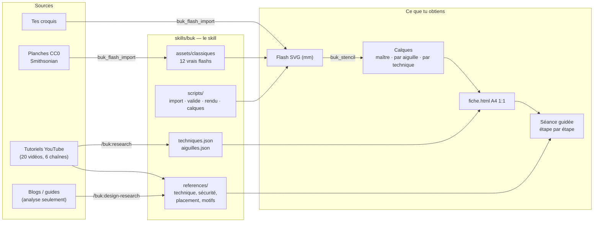
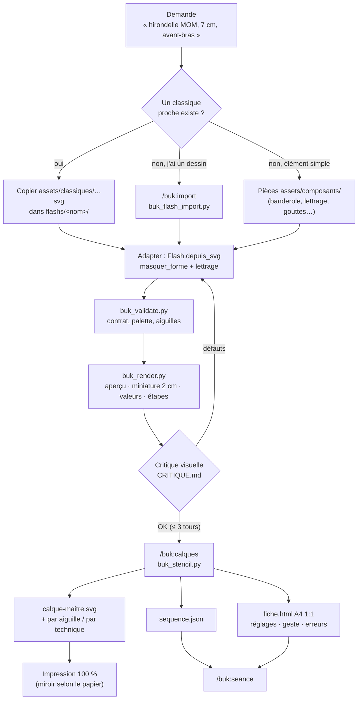
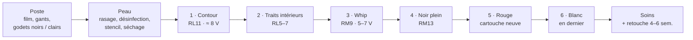
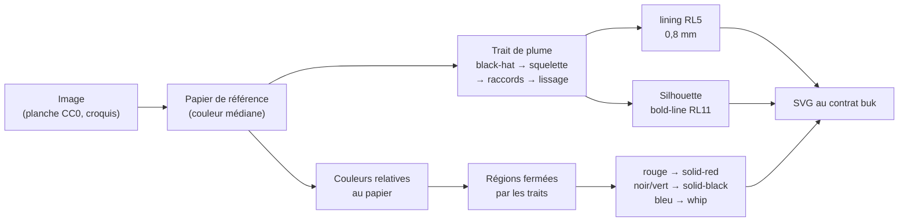
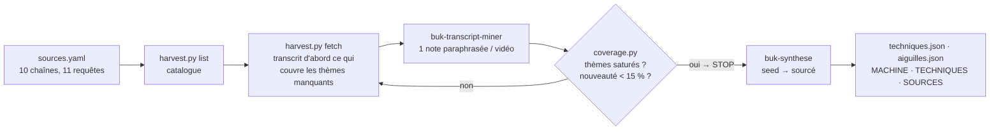

# ⚓ buk — tatoueur old school pour Claude

**buk** est un skill Claude qui joue le rôle d'un tatoueur traditionnel (American traditional /
old school) en **noir, rouge et blanc**. Avec un dermographe et du papier transfert, il :

- **part d'un vrai flash** (bibliothèque de planches du domaine public, ou ton croquis) et
  l'**adapte** à ta demande (taille, texte, emplacement) ;
- **génère les calques de transfert** — un calque maître, plus un calque **par aiguille** ou
  **par type d'ombrage** — et une **fiche imprimable** qui donne pour chaque calque l'aiguille,
  l'encre, les réglages machine, le geste et les erreurs à éviter ;
- **guide la séance** pas à pas, de la préparation du poste aux soins ;
- s'appuie sur une **recherche vidéo** (20 tutoriels, 6 chaînes) synthétisée dans le skill.

| | | | |
|---|---|---|---|
|  |  |  |  |
|  |  |  |  |

> ⚠️ buk ne remplace pas un apprentissage. Il impose l'hygiène (cartouches stériles à usage
> unique, film barrière, protocole de gants), refuse les cas à risque et rappelle le cadre légal
> (en France : formation hygiène de 21 h et déclaration ARS pour tatouer autrui). Le rouge est le
> pigment le plus allergisant : test cutané conseillé. Voir
> [`SECURITE.md`](skills/buk/references/SECURITE.md).

---

## Vue d'ensemble



## Démarrage

```bash
git clone https://github.com/nicolasmondain/buk && cd buk
make buk-link        # relie le skill pour Claude Code (.claude/skills/buk)
make buk-test        # 19 tests de bout en bout
make buk-demo        # régénère le flash d'exemple et ses calques
open flashs/dague-coeur/calques/fiche.html
```

| Besoin | Installation |
|---|---|
| Validation, calques, fiche | rien : Python ≥ 3.9, bibliothèque standard |
| Import de vrais dessins (`buk_flash_import.py`) | `pip install -r requirements-trace.txt` (OpenCV, numpy, pillow) |
| Rendu PNG pour la critique visuelle (`buk_render.py`) | `brew install librsvg` (ou cairosvg, ou Chrome) |
| Recherche vidéo | `pip install -r requirements.txt` (yt-dlp, pyyaml) |

## Toutes les commandes

Commandes Claude Code (dans le repo) — toutes préfixées `buk:` :

| Commande | Ce qu'elle fait |
|---|---|
| `/buk:flash rose et dague, 10 cm, avant-bras` | Part du classique le plus proche (ou d'un import), l'adapte, le valide, le critique visuellement, montre l'aperçu |
| `/buk:flash modifier rose : texte MOM sur la banderole` | Retouche le SVG existant |
| `/buk:import croquis.jpg` | Convertit un vrai dessin en flash buk (droits vérifiés) |
| `/buk:calques rose both --machine rotary` | Calques + fiche imprimable + séquence de séance |
| `/buk:seance rose` | Guide la séance, une étape à la fois |
| `/buk:research` · `status` · `synthese` | Recherche vidéo : collecte → notes → synthèse dans le skill |
| `/buk:design-research` | Analyse d'images de référence (principes, jamais de copie) |

Ou simplement, en langage naturel : « buk, je veux une rose old school de 8 cm sur le mollet ».

Agents : `buk` (le tatoueur), `buk-transcript-miner`, `buk-synthese`, `buk-flash-analyst`.
Cibles make : `make buk-help` les liste toutes (`buk-link`, `buk-test`, `buk-demo`,
`buk-classiques`, `buk-motifs`, `buk-package`, `buk-research-list`, `buk-research-fetch`,
`buk-coverage`, `buk-clean`).

## Du flash à la peau



### Exemple réel (essai de bout en bout)

« L'hirondelle FRIENDS de la planche, mais avec MOM » :

```python
import sys; sys.path.insert(0, "skills/buk/assets/composants")
from buk_composants import Flash
from buk_classiques import lettrage
f = Flash.depuis_svg("skills/buk/assets/classiques/hirondelle_friends.svg")
f.masquer_forme("M27 67.5 L40 70.5 L53 77.5 L62 78.5 L63.5 82.5 L58 85 L46 81.5 L33 77 L26.5 73.5 Z")
lettrage(f, "MOM", 46.5, 77.6, 6.2, ang=24)
f.ecrire("flashs/hirondelle-mom/hirondelle-mom.svg")
```

```bash
python3 skills/buk/scripts/buk_validate.py flashs/hirondelle-mom/hirondelle-mom.svg
python3 skills/buk/scripts/buk_stencil.py flashs/hirondelle-mom/hirondelle-mom.svg --by both --machine rotary
```

## Les calques

| Sortie | Rôle |
|---|---|
| `calque-maitre.svg` | le stencil à poser : traits pleins, limites de zones en pointillé, codes W/P/N/R/B |
| `calque-aiguille-<aiguille>-<encre>.svg` | tout ce qu'on fait avec une cartouche |
| `calque-technique-<technique>.svg` | tout ce qu'on fait avec un même geste (lining, whip, noir plein…) |
| `fiche.html` | A4 imprimable à l'échelle 1:1 : aperçu, déroulé, matériel, une page par calque avec réglages (tension, course, sortie d'aiguille), geste, critère de réussite, erreurs |
| `sequence.json` | ordre de séance pour l'agent |

Options : `--by needle|technique|both`, `--machine pen|rotary|coil`, `--scale 1.2`, `--mirror`.
Le papier décide du miroir : thermique ou hectographique → pas de miroir ; jet d'encre posé face
contre la peau → `--mirror` ([`CALQUES.md`](skills/buk/references/CALQUES.md), avec la pose et la
[petite histoire du stencil](skills/buk/references/HISTOIRE_STENCILS.md)).

## La séance



Les réglages viennent de [`techniques.json`](skills/buk/assets/techniques.json), sourcés par la
recherche vidéo ([`SOURCES.md`](skills/buk/references/SOURCES.md)) ; l'emplacement et la douleur
par zone dans [`PLACEMENT.md`](skills/buk/references/PLACEMENT.md).

## L'import de vrais dessins



On n'importe que ce qu'on a le droit d'utiliser : domaine public (CC0), tes dessins. Les images
de blogs, Pinterest ou d'artistes vivants servent à l'**analyse**, jamais à la copie ; une image
de banque d'images va dans `flashs/prive/` (ignoré par git). Détails :
[`IMPORT.md`](skills/buk/references/IMPORT.md), sources :
[`SOURCES_CC0.md`](research/design/SOURCES_CC0.md).

## La recherche vidéo



État : **20 vidéos, 6 chaînes, 135 affirmations, synthèse faite** — toutes les techniques sont
au statut *sourcé*. Les transcripts restent en local (`.gitignore`) ; le repo ne contient que des
notes reformulées, avec lien vers chaque vidéo.

## Pièces dessinées (secours) et critique visuelle

Pour un élément simple qui n'existe pas dans un vrai flash, buk dispose de pièces
paramétrables (`skills/buk/assets/composants/` : banderole, lettrage block A–Z/0–9, gouttes,
étoile nautique, fer à cheval, dés, cartes, ancre, crâne, cœur, dague, panthère, serpent,
flammes, toile, bateau, phare, pin-up) et de fiches de grammaire par motif
(`references/motifs/`). Avant de montrer quoi que ce soit, il **regarde** son dessin
(`buk_render.py` : aperçu, miniature 2 cm, carte des valeurs, planche d'étapes) et corrige.
Planches : `flashs/_motifs/`.

## Arborescence

```
buk/
├── skills/buk/                  ← le skill (ce qu'on installe dans Claude)
│   ├── SKILL.md                 point d'entrée : rôle, déroulé, quand lire quoi
│   ├── references/              sécurité, placement, technique, calques, motifs, sources
│   ├── assets/
│   │   ├── classiques/          12 vrais flashs CC0 au contrat buk
│   │   ├── composants/          pièces paramétrables (+ Flash.depuis_svg pour retoucher)
│   │   ├── techniques.json      réglages + gestes par technique (sourcés)
│   │   └── aiguilles.json       catalogue des configurations
│   └── scripts/                 buk_flash_import · buk_validate · buk_render · buk_stencil …
├── research/                    recherche vidéo (notes, couverture) et design (CC0, analyses)
├── .claude/
│   ├── agents/                  buk · buk-transcript-miner · buk-synthese · buk-flash-analyst
│   ├── commands/buk/            /buk:flash · import · calques · seance · research · design-research
│   └── skills/buk → ../../skills/buk
├── flashs/                      tes flashs (prive/ non versionné), _classiques/ et _motifs/ (aperçus)
└── tests/                       tests de bout en bout
```

## Installer le skill dans claude.ai / Claude Desktop

```bash
make buk-package     # → dist/buk.zip (skill + bibliothèque de classiques)
```

Puis **Paramètres → Capacités → Skills → Importer** `dist/buk.zip` (exécution de code activée).

## Licence

Code sous licence MIT. Flashs de la bibliothèque : planches du Smithsonian American Art Museum,
CC0. Les notes de recherche citent leurs sources ; les vidéos et images de référence restent la
propriété de leurs auteurs.
