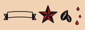
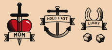
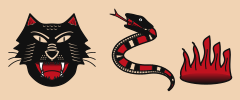
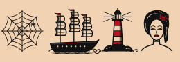

# buk — skill de tatoueur old school

**buk** est un skill Claude qui joue le rôle d'un tatoueur traditionnel (American traditional /
old school) en **noir, rouge et blanc**. Avec un dermographe et du papier transfert, il :

- **dessine** un flash sur demande et le **met à jour** à chaque retour ;
- **génère les calques de transfert** (stencils) — un calque maître, plus un calque **par
  aiguille** ou **par type d'ombrage** — et une **fiche technique imprimable** qui donne pour
  chaque calque l'aiguille, l'encre, les réglages machine, le geste et les erreurs à éviter ;
- **guide la séance** pas à pas, de la préparation du poste aux soins.

Ses connaissances techniques se construisent à partir de **vidéos YouTube** : un pipeline liste
les vidéos de chaînes choisies, récupère leurs transcripts, et un agent en tire des notes
paraphrasées jusqu'à ce que la matière soit suffisante — puis un second agent les fond dans le
skill.


> ⚠️ buk ne remplace pas un apprentissage. Il impose l'hygiène (cartouches stériles à usage
> unique, film barrière, gants), refuse les cas à risque et rappelle le cadre légal (en France :
> formation hygiène de 21 h et déclaration ARS pour tatouer autrui). Le rouge est le pigment le
> plus allergisant : test cutané conseillé. Voir [`SECURITE.md`](skills/buk/references/SECURITE.md).

## Arborescence

```
buk/
├── skills/buk/                  ← le skill (ce qu'on installe dans Claude)
│   ├── SKILL.md                 point d'entrée : rôle, workflow, quand lire quoi
│   ├── references/              savoir technique (chargé à la demande)
│   │   ├── SECURITE.md          hygiène, allergies, légalité, soins
│   │   ├── DESIGN_OLD_SCHOOL.md règles du style, palette, motifs
│   │   ├── SVG_CONTRAT.md       format des flashs (couches annotées)
│   │   ├── CHECKLIST_DESIGN.md  contrôle qualité avant livraison
│   │   ├── CALQUES.md           impression (miroir ou non), pose du stencil
│   │   ├── SEANCE.md            déroulé complet d'une séance
│   │   ├── AIGUILLES.md · ENCRES.md · MACHINE.md · TECHNIQUES.md
│   │   └── SOURCES.md           synthèse de la recherche vidéo (générée)
│   ├── assets/
│   │   ├── techniques.json      réglages + gestes par technique (lus par les scripts)
│   │   ├── aiguilles.json       catalogue des configurations
│   │   └── flash/               flashs d'exemple au bon format
│   └── scripts/
│       ├── buk_validate.py      vérifie un flash (contrat, palette, proportions)
│       ├── buk_stencil.py       aperçu + calques + fiche.html + sequence.json
│       ├── buk_trace.py         photo/croquis → base SVG à redessiner (OpenCV)
│       └── buk_lib.py           géométrie et lecture SVG (stdlib uniquement)
├── research/                    ← la recherche vidéo
│   ├── sources.yaml             chaînes et requêtes YouTube  ← à compléter
│   ├── themes.yaml              thèmes à couvrir + critère d'arrêt
│   ├── scripts/harvest.py       catalogue, transcrit (yt-dlp)
│   ├── scripts/coverage.py      mesure la couverture, dit quand s'arrêter
│   ├── notes/                   une note paraphrasée par vidéo (versionnée)
│   └── transcripts/             transcripts bruts (ignorés par git)
├── .claude/
│   ├── agents/                  buk · transcript-miner · buk-synthese
│   ├── commands/                /buk-flash · /buk-calques · /buk-seance · /buk-research
│   └── skills/buk → ../../skills/buk
├── flashs/                      tes flashs et leurs calques
└── tests/                       tests de bout en bout
```

## Démarrage

```bash
git clone https://github.com/nicolasmondain/buk && cd buk
make link                        # relie le skill pour Claude Code
make test                        # vérifie que tout fonctionne (Python ≥ 3.9, aucune dépendance)
make demo                        # régénère les calques du flash d'exemple
open flashs/dague-coeur/calques/fiche.html
```

Les scripts du skill n'utilisent que la bibliothèque standard Python. La recherche vidéo
demande `pip install -r requirements.txt` (yt-dlp, pyyaml) ; le tracé de photos
`pip install -r requirements-trace.txt` (OpenCV).

## Utilisation avec Claude Code (dans ce repo)

```text
/buk-flash hirondelle avec banderole vierge, 9 cm, poitrine gauche
/buk-flash modifier hirondelle : ailes plus ouvertes, plus de noir dans la queue
/buk-calques hirondelle needle --machine rotary
/buk-seance hirondelle
/buk-research            # lance / poursuit la recherche vidéo jusqu'à saturation
/buk-research status
```

Ou simplement : « buk, je veux une rose old school de 8 cm sur le mollet ».

## Installer le skill dans claude.ai / Claude Desktop

```bash
make package                     # → dist/buk.zip
```

Puis **Paramètres → Capacités → Skills → Importer** `dist/buk.zip` (l'exécution de code doit
être activée). Le skill se déclenche dès qu'on parle de flash, de calque ou de tatouage old school.

## Calques : par aiguille ou par technique

```bash
python3 skills/buk/scripts/buk_stencil.py flashs/rose/rose.svg --by needle
python3 skills/buk/scripts/buk_stencil.py flashs/rose/rose.svg --by technique
python3 skills/buk/scripts/buk_stencil.py flashs/rose/rose.svg --by both --mirror --machine coil --scale 1.2
```

| Sortie | Rôle |
|---|---|
| `calque-maitre.svg` | le stencil à poser : traits pleins, limites de zones en pointillé, codes W/P/N/R/B |
| `calque-aiguille-<aiguille>-<encre>.svg` | tout ce qu'on fait avec une cartouche |
| `calque-technique-<technique>.svg` | tout ce qu'on fait avec un même geste (lining, whip, noir plein…) |
| `fiche.html` | A4 imprimable à l'échelle 1:1 : aperçu, déroulé, matériel, une page par calque avec réglages et gestes |
| `sequence.json` | ordre de séance pour l'agent |

Le papier décide du miroir : thermique ou hectographique → pas de miroir ; papier jet d'encre posé
face contre la peau → `--mirror` (voir [`CALQUES.md`](skills/buk/references/CALQUES.md)).

## Bibliothèque de vrais flashs

buk part de **vrais flashs traditionnels** : 12 motifs tirés de planches du domaine public (CC0,
Smithsonian et Met, vers 1900–1950) et convertis au contrat buk par
`skills/buk/scripts/buk_flash_import.py` (trait de plume → lignes à épaisseur d'aiguille, aplats
rouge/noir, bleu → ombrage). Liste : [`flashs/_classiques/`](flashs/_classiques/README.md) ;
sources : [`research/design/SOURCES_CC0.md`](research/design/SOURCES_CC0.md).

| | | | |
|---|---|---|---|
|  |  |  |  |
|  |  |  |  |

Tes propres croquis passent par le même convertisseur :
`python3 skills/buk/scripts/buk_flash_import.py croquis.jpg --largeur-mm 70 --titre "…" -o flashs/x/x.svg`.

## Pièces dessinées par buk (secours)

buk dessine à partir d'une **bibliothèque de pièces** (rose, hirondelle, feuille, banderole,
goutte, étoile nautique, lettrage, fer à cheval, dés, cartes, ancre, crâne, cœur, dague, panthère,
serpent, flammes, toile d'araignée, bateau, phare, pin-up) et de **fiches de grammaire** par motif
(`skills/buk/references/motifs/`). Avant de montrer un dessin, il le **regarde** :
`buk_render.py` produit un aperçu, une miniature de 2 cm (lisibilité), une carte des valeurs
(noir / ombre / clair) et une planche d'étapes ; buk les lit, corrige les pires défauts et
recommence (protocole : `references/CRITIQUE.md`). Ses goûts s'affinent avec tes retours
(`references/PREFERENCES.md`).

| Rose | Hirondelles | Pièces |
|---|---|---|
|  |  |  |

| Classiques | Compositions |
|---|---|
|  |  |
| **Bestiaire** | **Marine et pin-up** |
|  |  |

Aussi : lettrage block A–Z / 0–9 (`flashs/_motifs/lettrage.svg`), cœur, dague et enseignes.

Planches de construction : `flashs/_motifs/*.planche.svg`. Rendu PNG : `brew install librsvg`.

**Recherche design** (`/buk-design-research`) : `research/design/sources_design.yaml` liste des
guides, blogs et archives old school ; l'agent `flash-analyst` regarde les images collectées,
les mesure (`research/design/analyse_image.py` : proportions noir/rouge, épaisseur des traits,
équilibre, lisibilité) et en tire des règles proposées dans `research/design/SYNTHESE.md`.
On en extrait des principes ; on ne recopie jamais un flash.

## La recherche vidéo

1. Ajoute tes chaînes dans [`research/sources.yaml`](research/sources.yaml) (nom suffit, l'URL est
   retrouvée) et ajuste les requêtes.
2. `/buk-research` dans Claude Code. La boucle :
   `harvest.py list` → `harvest.py fetch -n 5` (vidéos qui couvrent les thèmes manquants
   d'abord) → un agent `transcript-miner` par transcript, en parallèle → `coverage.py`.
3. **Arrêt automatique** quand chaque thème requis de [`themes.yaml`](research/themes.yaml) est
   couvert par ≥ 3 vidéos de ≥ 2 chaînes, ou quand les dernières vidéos n'apportent plus rien de
   nouveau (< 15 % d'affirmations nouvelles), ou au plafond de 60 vidéos.
4. `buk-synthese` met à jour `techniques.json`, `aiguilles.json`, les références et
   `SOURCES.md` ; les valeurs confirmées par plusieurs chaînes passent de **seed** à **sourcé**
   (badge visible sur la fiche).

Droits d'auteur : les transcripts restent en local (`.gitignore`) ; le repo ne contient que des
notes **reformulées** avec lien vers la vidéo source.

Sans terminal, `harvest.py` doit tourner sur une machine qui accède à YouTube (ton Mac) :
`pip install -r requirements.txt && python3 research/scripts/harvest.py list`.

## Le format d'un flash

Un flash est un SVG en millimètres dont chaque couche `<g>` dit **quoi**, **avec quoi** et
**quand** :

```xml
<g id="contour" data-buk-kind="line" data-technique="bold-line"
   data-needle="RL11" data-ink="noir" data-order="1"> … </g>
<g id="ombrage" data-buk-kind="zone" data-technique="whip"
   data-needle="RM9" data-ink="noir" data-order="3" data-direction="-45"> … </g>
```

Détails : [`SVG_CONTRAT.md`](skills/buk/references/SVG_CONTRAT.md).

## Licence

Code sous licence MIT. Les notes de recherche citent leurs sources ; les vidéos restent la
propriété de leurs auteurs.
